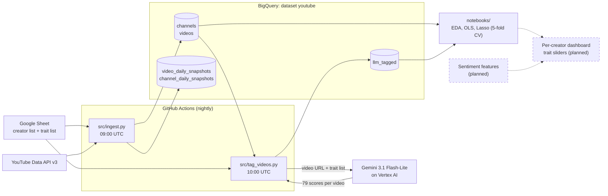

# YouTube Engagement Insight Tool

A data pipeline and modeling toolkit for measuring which content traits go with engagement on YouTube.
Every night it pulls channel and video data for a curated list of creators from the YouTube Data API into
BigQuery, and an LLM (Gemini on Vertex AI) watches new videos and scores each one on 79 content traits
(format, tone, production, audience hooks, subject matter). Regularized regression on those scores
estimates which traits are associated with views and likes. The goal is a per-creator dashboard where a
creator moves a slider per trait and sees the predicted effect; that part is planned.

Built for independent creators who don't have an analytics team. It started as a team project for USC's
DSO 585 (Data-Driven Consulting); background and research questions are in [docs/PROPOSAL.md](docs/PROPOSAL.md).

> Results describe associations in observational data, not causal effects.

<!-- TODO: credits (team members and roles, once teammates confirm they're fine being named) -->

## Status

Ongoing project. As of 2026-10-22:

| | |
|---|---|
| **Working** | Nightly ingest of channels, videos and daily engagement snapshots into BigQuery (GitHub Actions) |
| | Nightly LLM tagging of new videos on 79 traits, with spend and runtime caps |
| | Analysis notebooks: EDA, OLS baseline, Lasso with 5-fold cross-validation, AI-vs-human tag agreement |
| **In progress** | Normalizing engagement for video age, using the daily snapshots (needs a few weeks of history) |
| | Updating the notebooks to the current pipeline (pin a snapshot date so results are reproducible) |
| | Evaluating tag quality through downstream model performance and tag-twice consistency |
| **Planned** | Sentiment features (TODO: define the source) |
| | Per-creator dashboard with a slider per trait |
| | Audience-segment models and a recommender that suggests trait changes for a creator's next video |

## How it works



| Stage | Code | What it does |
|---|---|---|
| Creator and trait lists | [`src/sheet.py`](src/sheet.py), [`src/traits.py`](src/traits.py) | Read the team [Google Sheet](https://docs.google.com/spreadsheets/d/1TK60Al7OyGIbhZMVXZcjNbQjI0UmEqHp/edit?usp=sharing&ouid=101825006116878587105&rtpof=true&sd=true): which channels to track, and each trait's category, scale (0-4 or 0/1) and definition |
| Ingest | [`src/ingest.py`](src/ingest.py), [`src/youtube_api.py`](src/youtube_api.py) | For every channel on the sheet: upsert channel and video metadata, add new uploads from the past 365 days, re-fetch every video's counts, and write one snapshot row per video and per channel per day |
| Storage | [`src/bigquery_io.py`](src/bigquery_io.py) | Typed loads, upserts, and date-partitioned snapshot tables whose daily partition is overwritten, so rerunning a day is safe |
| Tagging | [`src/tag_videos.py`](src/tag_videos.py) | Gemini watches each video from its public URL and returns one integer per trait, enforced by a JSON schema. Queue: each channel's 50 newest videos of 30 minutes or less, round-robin across channels. Parallel requests with jittered retries; stops before the per-run spend cap |
| Modeling | [`notebooks/`](notebooks) | One-hot trait encoding plus YouTube metadata and tag features; OLS baseline, then Lasso with the penalty chosen by 5-fold CV on the training split and a held-out 20% test set |

## Automated workflows

Two GitHub Actions workflows run the pipeline. Both run on a schedule from `main` and can be started by
hand (Actions tab → workflow → **Run workflow**). They authenticate with the repository secrets
`GOOGLE_SERVICE_ACCOUNT_JSON` and `YOUTUBE_API_KEY`.

| | [Ingest videos](.github/workflows/ingest_videos.yml) | [Tag videos](.github/workflows/tag_videos.yml) |
|---|---|---|
| **When** | Daily 09:00 UTC | Daily 10:00 UTC, an hour after ingest |
| **Runs** | `python src/ingest.py --env github` | `python src/tag_videos.py --env github` |
| **Does** | Reads the creator list from the sheet; for those channels, upserts `channels` and `videos` (new uploads included) and writes today's partition of `video_daily_snapshots` and `channel_daily_snapshots`. Never deletes anything | Builds the queue of untagged eligible videos from the sheet's channels and scores them with Gemini; appends the scores to `llm_tagged` in batches |
| **Stops early** | Fails if the sheet has no usable channel URLs | Before the per-run spend cap ($25), near 300 minutes, or after 3 failed batches in a row; the next run resumes the queue |
| **Rerun** | Safe: overwrites today's snapshot partition | Safe: already-tagged videos are skipped |
| **Manual inputs** | None | `max_videos` (tag at most N), `dry_run` (print the queue and estimated cost only) |

Checking logs and troubleshooting failed runs: [GIT_WORKFLOW.md § 8](GIT_WORKFLOW.md#8-github-actions-checking-runs-and-troubleshooting).

## Using the dashboard

Not built yet.

<!-- TODO: screenshot of the dashboard once it exists -->
`[Screenshot placeholder: per-creator dashboard]`

TODO: describe each view and slider once built. The plan: pick a creator, move a slider per trait
(0-4), and see the model's predicted change in views, relative to that creator's typical video.

Until then, results live in the notebooks (see Results so far).

## Data

| | As of 2026-10-22 |
|---|---|
| Channels | 52, from the team sheet (curated across genres and sizes) |
| Videos | 13,216, published since 2025-10-15 (365-day window) |
| Traits | 79 in 5 categories: Format 33, Subject Matter 15, Tone and Emotion 11, Production 10, Audience Hooks 10. 75 scored 0-4, 4 binary |
| Tagged videos | 2,462 |
| Daily snapshots | Since 2026-10-15 (one row per video and per channel per day) |

**What's collected:** every field the YouTube Data API returns to an API key (title, description, tags,
category, duration, publish time, lifetime views, likes, comments, …), plus channel subscribers and totals.
Engagement counts are lifetime totals, so the daily snapshots are what make growth over time measurable.

**BigQuery tables** (dataset `youtube`): `channels`, `videos` (one row per video, latest values),
`video_daily_snapshots`, `channel_daily_snapshots` (date-partitioned), `llm_tagged` (one row per video,
one column per trait).

## Results so far

From a frozen sample of 726 videos tagged by 2026-10-15 (random 80/20 split; the channel list has changed
since, and the notebooks are being updated):

| Target | Model | Train R² | Test R² |
|---|---|---|---|
| log(views) | OLS, 372 columns | 0.89 | 0.19 |
| log(views) | Lasso (keeps 118 columns) | 0.76 | 0.66 |
| log(likes) | OLS | 0.89 | 0.14 |
| log(likes) | Lasso (keeps 125 columns) | 0.76 | 0.64 |

Plain OLS overfits (372 columns for 580 training videos); Lasso generalizes. Raw view and like counts
are dominated by a few viral videos and don't predict well on either model, so the log targets are used.

AI vs human tags, on the 5 hand-tagged videos also in the dataset: 64% exact agreement and 86% within one
point on the 0-4 scale (mean absolute difference 0.55); present/absent F1 0.76. Five videos is a small
sample.

## Setup and running

**Prerequisites**
- Python 3.12
- A Google Cloud project with these APIs enabled: YouTube Data API v3, BigQuery, Google Sheets, Vertex AI
- A service account with BigQuery Data Editor, BigQuery Job User and Vertex AI User (Agent Platform User);
  share the Google Sheet with its email
- A YouTube Data API key

**Credentials:** create a `.env` file in the repo root (it is gitignored) with these variables:

| Variable | Value |
|---|---|
| `YOUTUBE_API_KEY` | Your YouTube Data API key |
| `GOOGLE_APPLICATION_CREDENTIALS` | Path to the service-account JSON key (keep the key file outside the repo) |

GitHub Actions uses the repository secrets `YOUTUBE_API_KEY` and `GOOGLE_SERVICE_ACCOUNT_JSON` instead.
Sheet, project, dataset, tagging model and budget settings are in [`src/config.py`](src/config.py).

**Install**
```bash
python -m venv .venv && source .venv/bin/activate
pip install -r requirements.txt              # pipeline
pip install -r requirements-notebooks.txt    # also for the notebooks
```

**Run**
```bash
python src/ingest.py --env local             # pull everything into BigQuery (+ CSV copies in data/)
python src/tag_videos.py --dry-run           # show the tagging queue and estimated cost, no API calls
python src/tag_videos.py --max-videos 3      # tag a few videos as a test
python src/tag_videos.py                     # tag the queue (stops at the per-run spend cap)
jupyter notebook notebooks/                  # EDA and models (TODO: being updated to the current pipeline)
```
`--env github` writes BigQuery only (the scheduled runs use it).

Dashboard: TODO (not built yet).

## Repo structure

```
.github/workflows/   ingest_videos.yml (09:00 UTC), tag_videos.yml (10:00 UTC)
src/
  config.py          hand-maintained settings: sheet, BigQuery, scope, model, budget
  ingest.py          nightly ingest and daily snapshots
  tag_videos.py      Gemini trait tagging
  youtube_api.py     YouTube Data API wrappers
  bigquery_io.py     BigQuery reads, writes, snapshot tables
  sheet.py           creator list from the Google Sheet
  traits.py          trait list from the Google Sheet
notebooks/           00 EDA, 01 OLS baseline, 02 Lasso, 03 AI vs manual tags
docs/                PROPOSAL.md (original project proposal)
TODO.md              task list and open questions
```

## Contributing

- New to the repo or to Git? Read [GIT_WORKFLOW.md](GIT_WORKFLOW.md): branches, pull requests, setup, and
  how to check and troubleshoot the GitHub Actions runs.
- Using Claude Code? [CLAUDE.md](CLAUDE.md) holds the project context and a running status log.
- Open tasks and questions are in [TODO.md](TODO.md).
