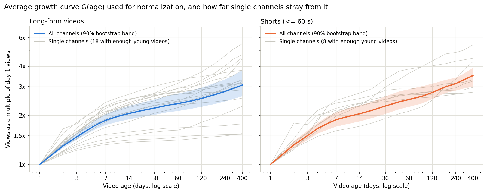
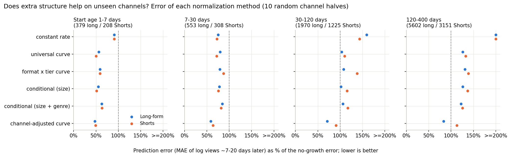
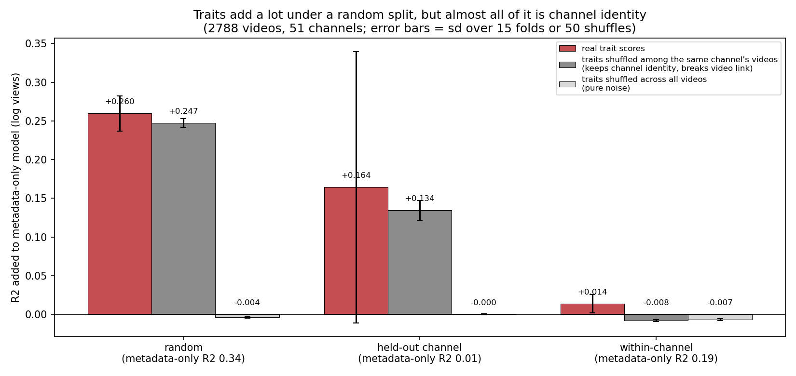
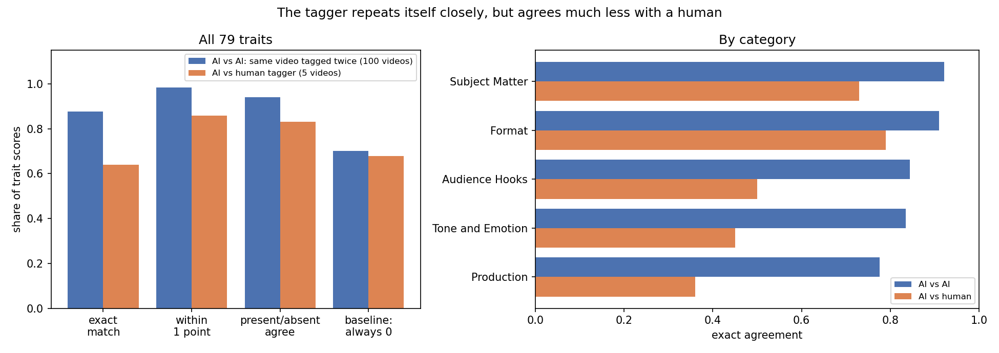
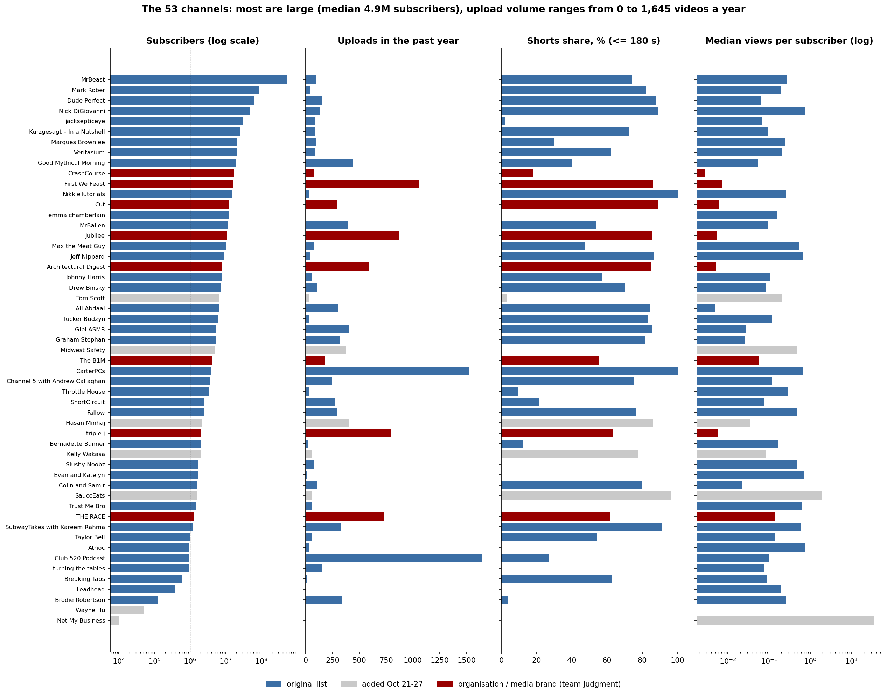
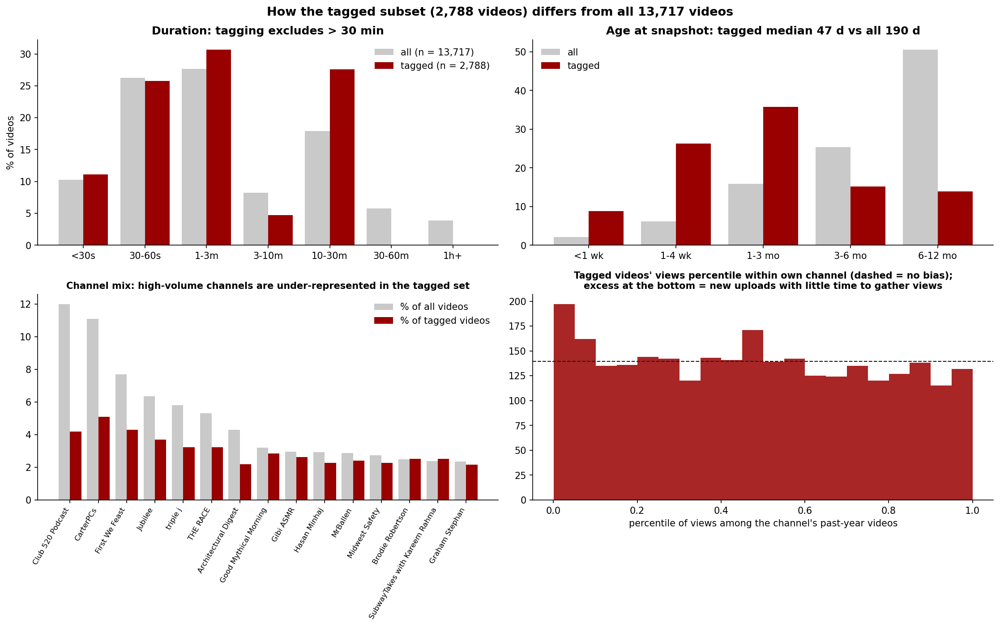

# Next steps: three questions for the professor (2026-11-04)

**Where we are.** A nightly pipeline tracks 53 creators and 13,717 videos (each channel's past-year uploads) in
BigQuery, with one engagement snapshot per video per day since Oct 21. Gemini has scored 2,788 of those videos on
79 content traits. We want your judgment on three problems before building the model further.

| # | Problem | What we need from you |
|---|---|---|
| 1 | Views depend on a video's age; how should we normalize? | Which target: curve-normalized views, or views observed at a fixed age? |
| 2 | How do we know the LLM tags are valid? | Which evaluation should be the yardstick, and is the signal we found enough? |
| 3 | Who does our creator sample represent? | How to define the population and whether to rebalance |

Analysis: `notebooks/04_eda_current.ipynb`, `05_age_normalization.ipynb`, `06_tag_downstream_eval.ipynb` (snapshot of 2026-11-04).

---

## 1. Normalizing engagement for video age

**What we see.** YouTube only reports lifetime totals, so an older video looks better just for being older.
From 188K consecutive daily pairs, a typical video's views grow ×1.9 from day 1 to 7, ×1.2 from day 7 to 30, and
about ×1.4 more by day 400. The two formats look alike up to day 30. The full correction from day 1 to day 400 is
about 1.2 log units, comparable to the spread of log views within a single channel (sd 0.95).

**What we tried.** We fitted the curve on half the channels and predicted later views for the other half:

- One curve per format cuts the prediction error compared with assuming no growth: by about 45% for videos under a
  week old, and by 21-28% for videos 7-30 days old.
- Giving the curve channel size or genre does **not** help on unseen channels. It fits the training channels better
  and then does worse on new ones.
- Adjusting for each channel's own typical decay (measured on its other videos) helps the most.
- Past 30 days we can't validate yet: each video has been tracked for at most ~3 weeks, so the long end of the
  curve is stitched together from different videos.
- Early rank is very stable (Spearman day 1 vs day 7: 0.95 long-form, 0.98 Shorts).

**Options.**
- **A.** Normalize every tagged video to a reference age with the curve. All 2,788 videos stay in, but older
  videos rely on the unvalidated part of the curve.
- **B.** Use views observed directly at day 7, for videos uploaded since we started daily snapshots. No curve is
  needed, but it's 256 videos today, growing by about 250 a week.
- **C.** Don't normalize the target; control for age in the trait model (e.g. age bins).

**Questions.**
1. Which option should the main analysis use: A, B, C, or B as the main result with A as a check?
2. Should the channel's typical decay be part of the normalization? It improves prediction, but it might absorb
   part of a creator's style, which is what we want to measure. (We already avoid using a video's own early growth
   for the same reason: it would absorb the trait effects.)
3. Reference age: 7 days (observed directly) or 30 days (needs the stitched curve)?

---

## 2. Validating the LLM tags through the downstream model

**What we see.** We compared a model with YouTube metadata only (age, duration, subscribers, publish time, title
length, …) against metadata plus the 79 traits, under three evaluations. Each was checked against two controls
with the traits shuffled.

- **Random split:** the traits add a lot (+0.26 R²). But traits shuffled among videos of the *same channel* keep
  95% of that gain. Most of it is the traits identifying which channel a video comes from, not anything about the
  video itself.
- **Held-out channels:** +0.16 R², mostly from a channel's overall trait mix, with very large fold-to-fold noise
  (51 channels).
- **Within a channel** (which videos do better than their own channel's average): +0.014 R² on views (+0.033 on
  likes). Small, but above every one of 50 shuffled runs.
- **Encoding:** a single 0-4 number per trait works best. Present/absent loses the within-channel signal, so the
  intensity scale carries information; one column per level adds nothing.
- **Categories:** within a channel, Tone and Emotion and Audience Hooks carry the signal; Subject Matter does not.

**Is the tagger consistent?** We re-tagged 100 videos with the same prompt and model ($0.50).

The tagger agrees with itself 88% of the time exactly (98% within one point), but only 64% with our single human
tagger (5 videos). So its disagreement with humans is systematic (how it reads the definitions), not random noise.
Production traits are the least consistent on both counts.

**Questions.**
1. What should count as "valid" tags: repeatable (yes), agreeing with humans (only 5 videos so far), or predictive
   within a channel (small)? Should we build a larger human-tagged set (30-50 videos) to measure the bias?
2. Which evaluation is the right yardstick: within-channel (advice to one creator) or held-out channel (a new
   creator)? We think the random split should be dropped.
3. Is a within-channel gain of 0.01-0.03 R² enough to build recommendations on? If not, is the better next step a
   different target (e.g. views relative to the channel's recent median, like rate) or new inputs (titles,
   thumbnails, transcripts)?
4. Should traits that mostly identify a type of channel (music performance, podcast, livestream highlights) become
   controls rather than advice?

---

## 3. Who our creator sample represents

**What we see.**

- **Large channels dominate.** The median channel has 4.9M subscribers; 9 channels are under 1M and 3 under 500K.
  MrBeast alone has half of all subscribers in the sample and 48% of all views.
- **8 channels are organisations or media brands** by our judgment (e.g. a radio station, a magazine), not
  independent creators. They account for 33% of all videos.
- **Upload volume ranges from 0 to 1,645 videos a year.** The top 5 uploaders account for 43% of videos.
- **The channel explains 68% of the variance in log views.** For channel-level questions the effective sample is
  about 51 channels, not 2,788 videos.

- **The tagged subset is recent and short:** median age 47 days vs 190, and no videos over 30 minutes (12% of the
  untagged videos are). This follows from the tagging rule: each channel's 50 newest videos of 30 minutes or less,
  plus new uploads nightly.
- **It's flatter across channels than the full data,** with no bias toward a channel's hits or misses.

**Questions.**
1. Population: should brands and organisations be dropped? Should we set minimum and maximum channel sizes, or
   focus on smaller creators, the ones the tool is meant for?
2. Should channels be weighted equally, or should we tag more of the high-volume channels? Should the
   "50 newest" rule become random sampling across the year?
3. Is it acceptable to leave out videos over 30 minutes (mostly podcasts)?

---

**One definitional note.** YouTube Shorts can now be up to 3 minutes long. The age analysis uses "60 seconds or
less" (36% of videos); the EDA and tag evaluation use "3 minutes or less" (64%). We'll standardize on whichever
you think is more meaningful.
